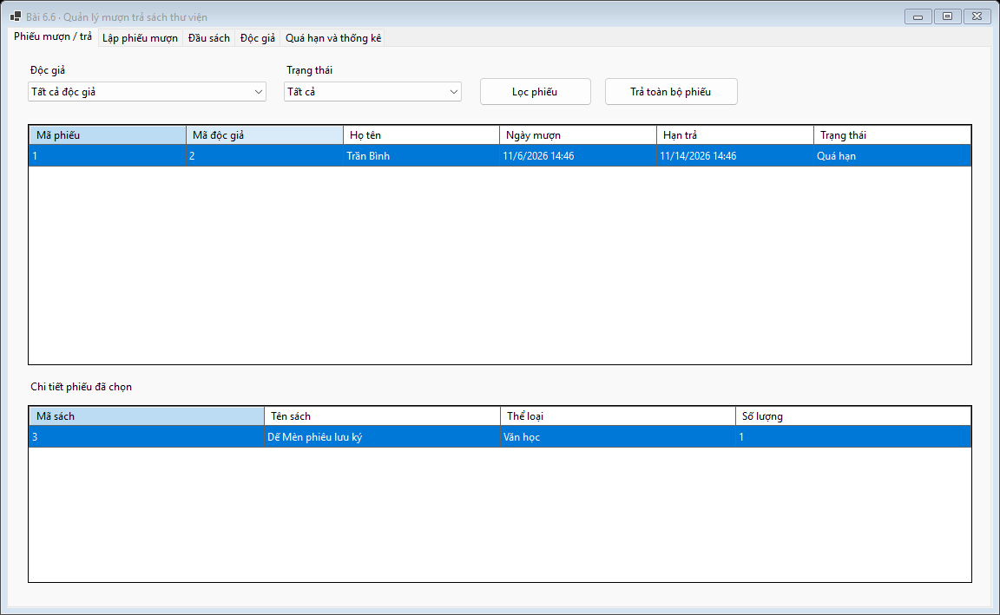
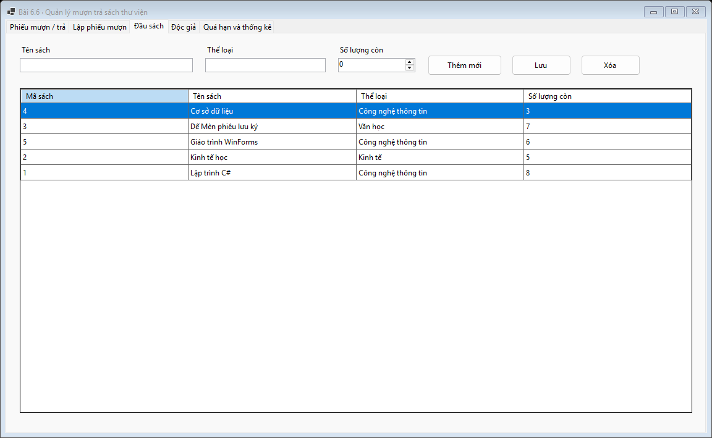
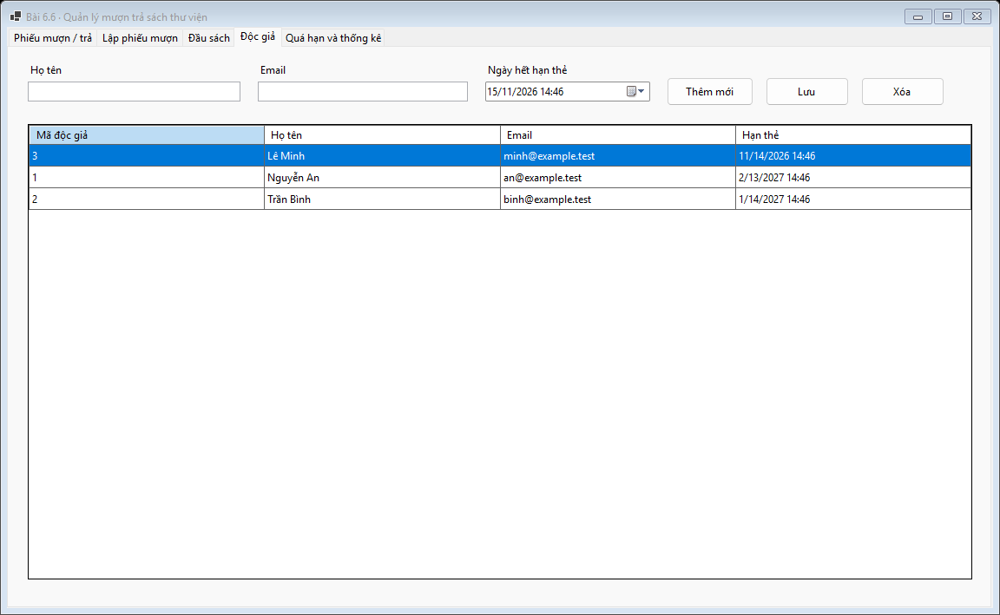
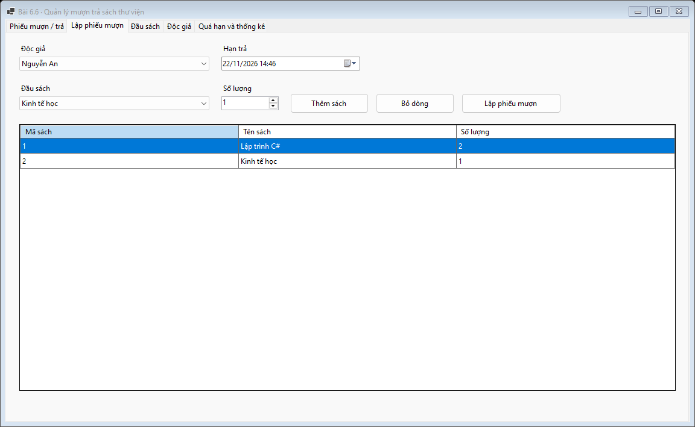
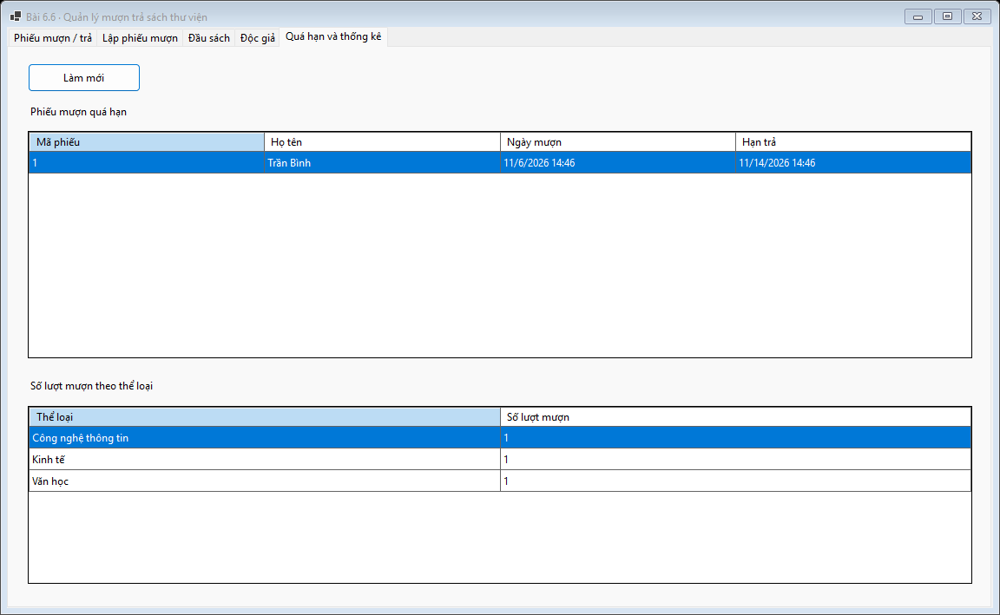

# Bài 6.6 - Hệ thống quản lý mượn trả sách thư viện

## Mục 1. Thông tin sinh viên

- Họ và tên sinh viên: Phạm Tuấn Thành
- Mã sinh viên: 24810320264
- Lớp / Khóa: D19QTANM1

### Cách chạy

1. Chạy [Database/ScriptDB.sql](Database/ScriptDB.sql) trên SQL Server để tạo CSDL `LibraryDB` và dữ liệu mẫu. Ứng dụng mặc định kết nối với `(localdb)\MSSQLLocalDB`.
2. Mở [LibraryManagement.sln](LibraryManagement.sln) trong Visual Studio có workload **.NET desktop development** và SDK .NET 8. Nếu dùng máy chủ khác, cấu hình biến môi trường `LIBRARYDB_CONNECTION` với chuỗi kết nối đến CSDL đã tạo.
3. Nhấn **F5** để chạy. Trong Solution Explorer, chọn **GUI/MainForm.cs** và chọn **View Designer** để mở giao diện thiết kế.

### Quy tắc đã thống nhất

Lập phiếu khi thẻ còn hạn theo giờ SQL Server. Trả toàn bộ phiếu trong một giao dịch, kể cả phiếu quá hạn. Đầu sách và độc giả đã có lịch sử mượn được giữ lại. Mỗi đầu sách trong một phiếu tính một lượt mượn khi thống kê theo thể loại.

## Mục 2. Hình ảnh kết quả các màn hình chức năng

### 1. Danh sách và bộ lọc phiếu mượn

### 2. Quản lý đầu sách

### 3. Quản lý độc giả

### 4. Lập phiếu mượn nhiều đầu sách

### 5. Phiếu quá hạn và thống kê theo thể loại

